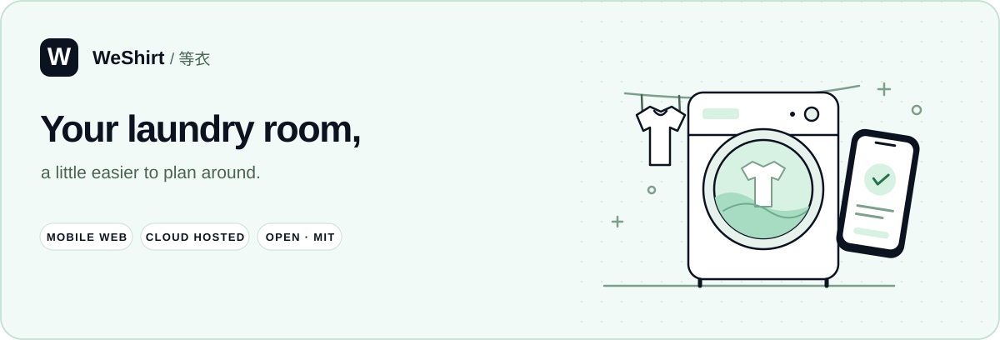
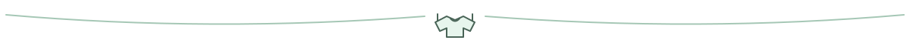
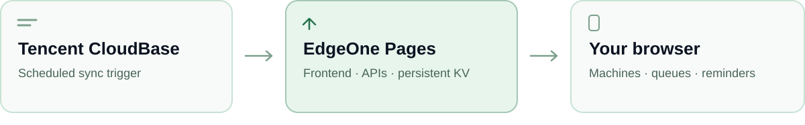

# WeShirt

<p align="center">
  
</p>

<p align="center">
  <a href="README.md">中文</a> · <b>English</b> · <a href="docs/DEPLOYMENT.en.md">Deployment</a> · <a href="https://github.com/LaokeQwQ/WeShirt/issues">Report an issue</a>
</p>

Check the machines before carrying your laundry downstairs. WeShirt is a web app for dorm laundry rooms, with machine availability, laundry progress, queues and pickup reminders.

Use it in your phone's browser. Choose your dorm once; it will be remembered the next time you visit.



## Machines, queues and pickup

| When | What you can do |
| --- | --- |
| Before washing | Find idle machines, switch between list and 3D views, and save favorites |
| Waiting for a machine | Check your queue position and estimated availability, or use the dorm message board |
| During a cycle | Register a wash or dry task, follow the countdown and get a pickup reminder |
| Helping a friend | Arrange pickup with friends and confirm when the laundry has been collected |

Admins can maintain dorms, machine locations, announcements and notifications, and assign dorm inspections to volunteers. See [configuration](docs/CONFIGURATION.en.md) for the details.

Machine status comes from Haile Life. Estimates help with planning; check the machine in person before use. WeShirt does not start machines or handle payments.

## Run it in the cloud

The recommended **Tencent CloudBase + Tencent EdgeOne Pages** setup gives your laundry room a fully cloud-hosted SaaS site, with no server of your own to maintain.



EdgeOne Pages hosts the frontend, Edge APIs and persistent KV. CloudBase schedules sync and can also fetch complete machine snapshots through a separate network route, then pass them to the same processing flow. Checks continue without an open page. This setup does not use a CloudBase database.

Use `master` for production, `npm ci && npm run build` as the build command, and `dist` as the output directory. Follow the [deployment guide](docs/DEPLOYMENT.en.md) for KV, login and scheduled sync.

## Try it locally

You need **Node.js 22.18+** and npm.

```bash
git clone https://github.com/LaokeQwQ/WeShirt.git
cd WeShirt
npm ci
cp .env.example .env
```

Edit `.env` and set two separate random values:

```dotenv
AUTH_SECRET=your-random-value-at-least-16-characters
ADMIN_TOKEN=another-random-value-at-least-8-characters
```

Then start the app:

```bash
npm run dev
```

Open [localhost:5173](http://localhost:5173) to explore the mock machines. The admin route is `/#/admin`.

In PowerShell, copy the configuration with `Copy-Item .env.example .env`. Real machine data, DingTalk login and notifications need additional configuration. Local mock mode does not operate real machines.

## Documentation

| Document | Contents |
| --- | --- |
| [Configuration](docs/CONFIGURATION.en.md) | Data sources, dorms, login, notifications and site settings |
| [Deployment](docs/DEPLOYMENT.en.md) | EdgeOne Pages, CloudBase, KV and optional Node hosting |
| [Development](docs/DEVELOPMENT.en.md) | Local work, verification and `dev` → `master` releases |
| [Privacy and usage](docs/PRIVACY.en.md) | Public information, stored data and user preferences |
| [Sync and networking](docs/EGRESS.en.md) | Scheduled sync and upstream troubleshooting |

Each document also has a Chinese version.


## Acknowledgments

Thanks to [PA733 / Laundry-Status-Monitor](https://github.com/PA733/Laundry-Status-Monitor) for the groundwork and ideas around machine monitoring and notifications.

The project uses the [MIT license](LICENSE). Third-party dependencies retain their own licenses.
