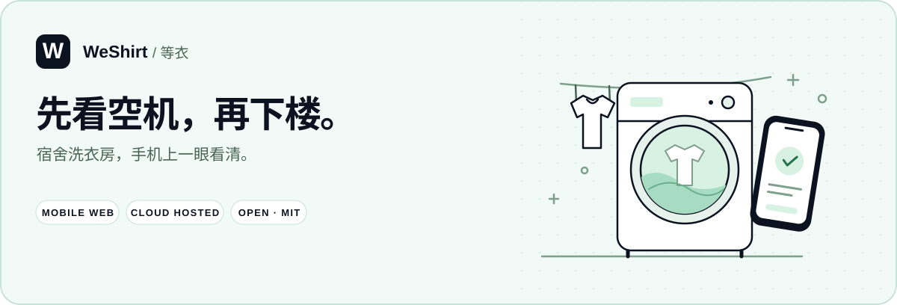
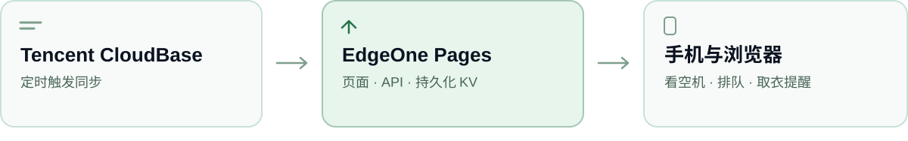

# WeShirt · 等衣

<p align="center">
  
</p>

<p align="center">
  <b>中文</b> · <a href="README.en.md">English</a> · <a href="docs/DEPLOYMENT.md">部署指南</a> · <a href="https://github.com/LaokeQwQ/WeShirt/issues">反馈问题</a>
</p>

端着衣服出门前，先看看楼里的机器。WeShirt 是一个宿舍洗衣房网页：查空机、记住洗衣进度，也方便大家排队和取衣。

手机浏览器就能用。第一次选好住宿楼，下次直接打开自己的楼栋。


## 看空机、排队和取衣

| 什么时候 | 可以做什么 |
| --- | --- |
| 准备洗衣 | 看空闲机器，切换列表或 3D 视图，收藏常用机位 |
| 等待机器 | 查看排位和预计可用时间，在楼栋留言板交流 |
| 正在洗衣 | 登记洗衣或烘干，查看倒计时，接收取衣提醒 |
| 帮忙取衣 | 联系朋友、发起代取，取走后确认完成 |

后台可维护楼栋、机位、公告和通知，也能给志愿管理员分配巡检楼栋。更多设置见[配置说明](docs/CONFIGURATION.md)。

设备状态来自海乐生活。预计时间供安排洗衣参考，使用机器前仍请确认现场状态；网页不负责启动机器或支付。

## 全云端部署

推荐使用 **腾讯 CloudBase + 腾讯 EdgeOne Pages**，搭建自己的全云端 SaaS 洗衣房站点，无需自建服务器。



EdgeOne Pages 负责网页、Edge API 和持久化 KV；CloudBase 定时触发同步，也可作为独立抓取出口，将完整设备快照交回同一套处理流程。无人访问时也会检查机器状态，不使用 CloudBase 数据库。

生产分支选 `master`，构建命令为 `npm ci && npm run build`，输出目录为 `dist`。KV 绑定、登录配置和定时触发步骤见[部署指南](docs/DEPLOYMENT.md)。

## 先在本地看看

需要 **Node.js 22.18+** 和 npm。

```bash
git clone https://github.com/LaokeQwQ/WeShirt.git
cd WeShirt
npm ci
cp .env.example .env
```

编辑 `.env`，填写各自独立的随机值：

```dotenv
AUTH_SECRET=至少16字符的随机值
ADMIN_TOKEN=至少8字符的随机值
```

然后启动：

```bash
npm run dev
```

打开 [localhost:5173](http://localhost:5173)，从模拟设备看起。后台入口是 `/#/admin`。

PowerShell 复制配置可用 `Copy-Item .env.example .env`。真实设备、钉钉登录和消息通知需要另行配置；本地模拟模式不会操作真实机器。

## 文档

| 文档 | 内容 |
| --- | --- |
| [配置](docs/CONFIGURATION.md) | 数据源、楼栋、登录、通知和网站设置 |
| [部署](docs/DEPLOYMENT.md) | EdgeOne Pages、CloudBase、KV 和可选 Node 部署 |
| [开发](docs/DEVELOPMENT.md) | 本地开发、验证，以及 `dev` → `master` 发布 |
| [隐私与使用](docs/PRIVACY.md) | 哪些信息公开、保存什么数据、如何管理偏好 |
| [同步与网络](docs/EGRESS.md) | 定时同步和上游连接排查 |

以上文档均提供英文版本。


## 致谢

感谢 [PA733 / Laundry-Status-Monitor](https://github.com/PA733/Laundry-Status-Monitor) 的轮子支持，为设备状态监测与通知提供了参考。

项目采用 [MIT 许可证](LICENSE)。第三方依赖遵循各自许可证。
